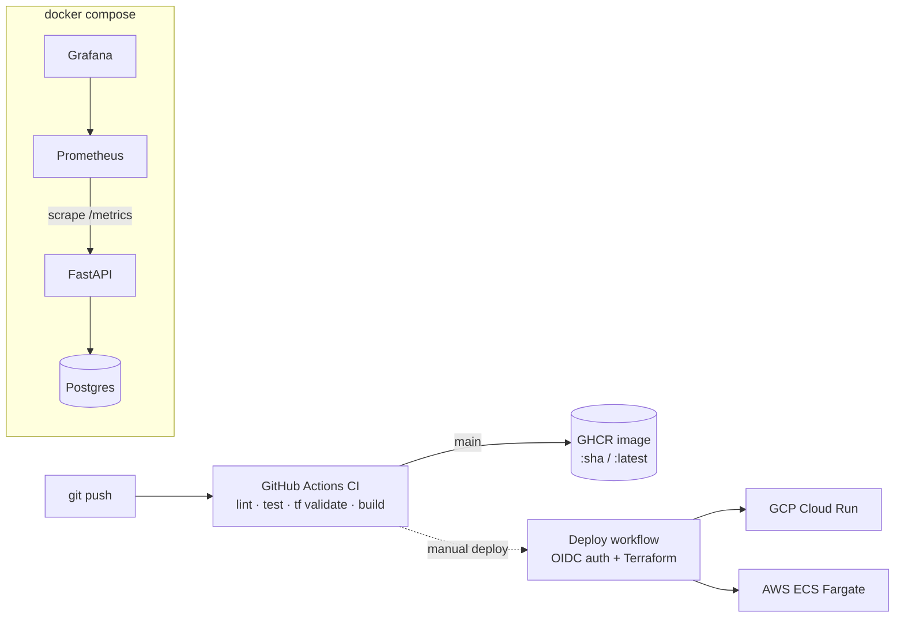

# DevOps Starter Kit (reference implementation)

> **Reference implementation / demo project.** It shows the setup I deliver when a client asks me to "Dockerize it, add CI/CD and get it on the cloud". It is not client work.

A small **FastAPI + Postgres** service, wrapped in everything a production app needs: a **multi-stage Docker** image, **GitHub Actions** CI that lints, tests and pushes to **GHCR**, **Terraform** for **GCP Cloud Run** and **AWS ECS Fargate**, and **Prometheus + Grafana** monitoring.


## The problem
Many startups deploy from one developer's laptop. There's no repeatable build, no tests gating releases, no health checks, and nobody knows the app is down until a customer says so.

## The solution
| Area | What's included |
|---|---|
| **Container** | Multi-stage Dockerfile, non-root user, `HEALTHCHECK`, slim runtime image |
| **Local dev** | `docker compose up`: API + Postgres + Prometheus + Grafana (pre-provisioned dashboard) |
| **CI** (`ci.yml`) | ruff lint → pytest → Terraform fmt/validate (both clouds) → Docker build → smoke test → push `:sha` + `:latest` to GHCR on `main` |
| **CD** (`deploy.yml`) | Manual `workflow_dispatch` to Cloud Run or ECS Fargate. Uses OIDC / Workload Identity (no long-lived cloud keys) and **skips cleanly until secrets are configured** |
| **Infra** | Terraform: Cloud Run v2 (scale-to-zero, probes, public invoker toggle), ECS Fargate (cluster, task, service, circuit-breaker rollback, CloudWatch logs). Remote state in GCS / S3 |
| **Observability** | `/healthz` (liveness), `/readyz` (DB check), `/metrics` (request count + latency histogram). Grafana dashboard: RPS, 5xx ratio, p95 latency |

## Architecture


## Quickstart (one command)
```bash
make up        # API :8080 · Grafana :3000 · Prometheus :9090
```
No Docker? `make install && make dev` runs the API on SQLite.

```bash
curl localhost:8080/healthz
curl -X POST localhost:8080/api/notes -H 'content-type: application/json' -d '{"text":"ship it"}'
make test && make lint && make tf-validate
```

## Deploy
The deploy workflow does nothing until you add these repository secrets:

- **GCP Cloud Run:** `GCP_WORKLOAD_IDENTITY_PROVIDER`, `GCP_SERVICE_ACCOUNT`, `GCP_PROJECT_ID`, `TF_STATE_BUCKET` (optional vars: `GCP_REGION`, `GCP_AR_REPO`). The image is built and pushed to Artifact Registry, then applied with Terraform.
- **AWS ECS Fargate:** `AWS_ROLE_ARN` (GitHub OIDC role), `TF_STATE_BUCKET_AWS` (optional var: `AWS_REGION`). Uses the GHCR image from CI. Make the package public, or add registry credentials.

Then go to **Actions → Deploy → Run workflow** and pick the target.

For production, the next steps would be: Cloud SQL / RDS instead of SQLite, a secrets manager, an ALB + private subnets on AWS, and alerting rules.

## How I'd adapt this for your business
- Swap the sample API for **your app** (Node, Python, Java, Go): same pipeline, same infra
- Add **staging + production** environments with approval gates
- Connect a **managed database**, migrations and backups
- **Cost review**: right-size instances, scale to zero, budget alerts
- **Kubernetes** (GKE/EKS + Helm/Argo CD) when you outgrow serverless containers

## Contact
Want this setup for your app? Email **divyansh.sharma.swe@gmail.com** with your stack and where it runs today.

License: MIT
